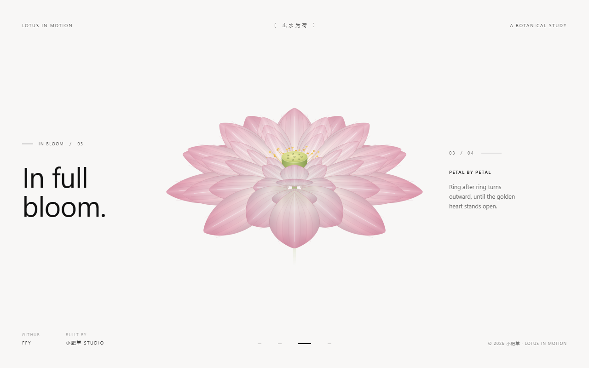

# 超级网页案例一 · 荷花绽放变色

一朵荷花逐瓣绽放、并整体变色 —— 单个 HTML 文件，纯 SVG 矢量绘制，零外部依赖、零网络请求。

点击页面任意位置（或按 `空格` / `←` `→` / 数字键 `1`~`4`）在四个状态间循环前进。

## 在线预览

开启 GitHub Pages 后访问：

```
https://<你的用户名>.github.io/<仓库名>/
```

## 本地打开

下载 `index.html`，双击用浏览器打开即可；也可以用 `?s=1..4` 直达任一状态（如 `index.html?s=3`）。

## 四个状态

| # | 标签 | 形态 | 说明 |
|---|---|---|---|
| 01 | Potential | 花苞 | 51 片花瓣全部收拢成纺锤形，第一下动作还没发生 |
| 02 | Awakening | 初绽 | 仅外两层微启约 12°，光从缝隙里进来 |
| 03 | In Bloom | 盛放 | 八轮花瓣全部展开，金色花蕊与青色莲蓬袒露在空气里 |
| 04 | Moonlit | 月色 | 同一朵花转为冷调靛蓝，瓣缘泛银光，背景同步转冷 |



## 技术要点

- **真·逐瓣绽放**：每片花瓣绕自身基部旋转，不是图片淡入淡出
- **8 轮 51 片花瓣**：每轮写死 `{ 片数 / 半径 / 尺度 / 倾角 / 色阶 }`，相邻轮错开半瓣
- **3D 方位角 + 正交投影**：仰角 26°，屏幕转角由 `atan2(sinT·cosφ, cosT·cosE − sinT·sinφ·sinE)` 计算，保证严格左右镜像对称
- **阻尼弹簧**：`spring(t) = 1 − e^(−6.2t)·cos(6.4t)`，全程 1650ms，约 4–5% 过冲，可随时打断重定目标
- **逐层错峰 90ms**：绽放外层先动，收拢内层先收
- **深度排序**：后半圈 → 莲蓬花蕊 → 前半圈，48 根花蕊按 3D 外倾投影
- **单文件 34KB**：内联 CSS / JS，不引用任何外部图片、字体、CDN，尊重 `prefers-reduced-motion`

## 提示词（两次迭代，可直接照抄）

<details>
<summary>展开：第 1 次提示词（搭舞台与四态）</summary>

```
【作品与硬约束】做一个单文件网页《荷花数字标本馆》：纯 SVG 矢量绘制的一朵荷花，点击页面任意位置在四个状态间循环前进。所有 HTML/CSS/JS 内联在一个 index.html 里；不引用任何外部图片、字体、CDN、网络请求；不要生成任何图片；动画只用 transform/opacity/filter；尊重 prefers-reduced-motion。

【四态】01 花苞（闭合纺锤形）→ 02 初绽（仅外两层微启约 12°）→ 03 盛放（全部展开，露出金色花蕊与青色莲蓬）→ 04 月色（整朵转为冷调靛蓝、瓣缘泛银光）→ 回到 01。左标签：Potential / Awakening / In Bloom / Moonlit；主标题两行断句：Before the bloom. / The first opening. / In full bloom. / Blue, in full.（右注英文一并写死，不要自拟）。

【版式】瑞士国际主义 × 东方留白 × 植物学图鉴：顶部通栏三组 10px、字距 0.18em 的大写小字「LOTUS IN MOTION /〔出水为荷〕/ A BOTANICAL STUDY」；左侧细线 + 编号 + 两行 72px 大标题；右侧「01 / 04」编号 + 小标题 + 约 24 字符宽说明；底部四段进度条，当前段 28px 近黑。

【动效】必须真·逐瓣绽放：每片花瓣绕自身基部旋转，禁止任何图片淡入淡出；逐层错峰 80ms；缓动 cubic-bezier(0.16,1,0.3,1)，收尾 3–5° 过冲回弹；背景色随状态 1.6s 过渡；标题切换用 clip-path 揭开。

【色板】背景 #FBF9F5 → #FAF8F5 → #F8F7F6 → #F2F5F9；花瓣由基部象牙白过渡到瓣尖荷粉，外层浓、内层淡；月色层整体替换为月白到靛蓝渐变，银边 rgba(220,235,255,.85)；文字 #1A1A1A / #111 / #6B6B6B。

【自检】支持 URL 参数 ?s=1..4 直达四态；1280×800 下自查：02 态花必须左右对称，03 态花心可见金色花蕊与青色莲蓬，04 态背景偏冷蓝，控制台无错误。
```

</details>

<details>
<summary>展开：第 2 次提示词（几何、动效与验收升级）</summary>

```
【几何升级】花改为 8 轮共 51 片花瓣（含前排 3 片压在栈顶的「破界」瓣），每轮写死一张参数表：{片数 n、盛放半径 r、合苞半径 rb、尺度 s、合苞倾角 tb、盛放倾角 to、色阶 c}——外层 {8, 46, 25, 1.00, −8°, 96°}，向内逐轮递减到 {4, 12, 4, 0.48, −1°, 40°}；相邻轮错开半瓣。花瓣路径用一条左右严格对称的贝塞尔尖卵形（基部窄、中段最宽、瓣尖微钝，长 262），transform-origin 设在基部中心。

【3D 排布】观察仰角 26°。每片花瓣按方位角 φ=(90+360i/n)° 绕花心均分（保证左右镜像对称），先算 3D 倾角 T=tb+(to−tb)×p，再把方向向量正交投影到屏幕：屏幕转角 rot=atan2(sinT·cosφ, cosT·cosE−sinT·sinφ·sinE)，长度取投影模长。禁止对 rot 做线性插值——这是 02 态歪苞的唯一原因。

【动效升级】开放度 p 用阻尼弹簧推进：spring(t)=1−e^(−6.2t)·cos(6.4t)，全程 1650ms、逐层错峰 90ms；绽放外层先动、收拢内层先收；动画可随时打断重定目标（from=当前值），连点不卡。

【质感细节】侧向近边缘的瓣收窄成薄片（宽度系数最小 0.56−0.24p），杜绝唇形色块；每瓣叠四层：日色渐变底、横向体积渐变（瓣缘暗、中脊亮）、基部暖影、白脊线+侧脉；莲蓬加大（高 66、顶面半径 31），48 根花蕊按 3D 外倾投影，后半画在莲蓬之后、前半画在之前；月色层与日色层交叉淡化，逐层延迟 70ms。

【验收闭环】像素验收：01 态背景均值 ≈ RGB(251,249,245)；03 态花心区域出现金色像素；04 态花瓣边缘出现 (220,235,255) 系银蓝；02 态左右半图像素差 < 2%（严格镜像对称）；控制台无错误。
```

</details>

## 目录

```
index.html          单文件网页（全部代码在这里）
preview/            四态截图
README.md           本说明
```

---

腾讯青科实训 · AI Coding 全栈开发主题营 · 拓展专题「超级网页 · 高级质感动效」
